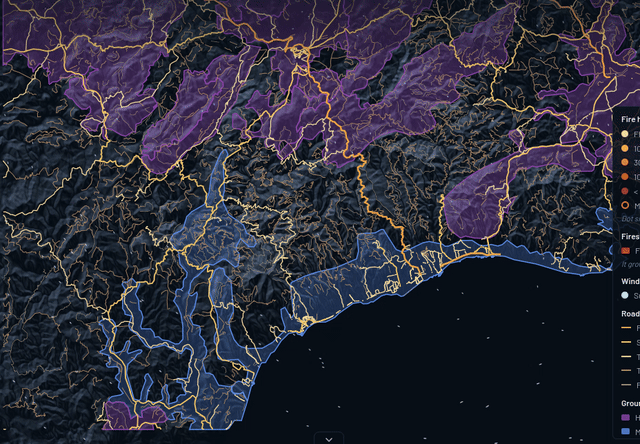

# Ulinautas

Wildfire hotspots from the **MODIS** and **VIIRS** satellites (NASA FIRMS), **harmonized into one dataset** and replayed on a web map: fires that grow over time, wind, population alerts, risk and evacuation estimates.



**Live demo: <https://maj-e.github.io/basajaun/>** (published from `main`; it opens on Sierra Bermeja, Málaga, paused on the peak of the fire — press play).

> Hackathon project. **Everything in this repository is in English** — code, UI, documentation, data field names.

---

## What it does

- **One dataset from two satellites.** MODIS (~1 km) and VIIRS (~375 m) normalized to one schema, double detections merged; the map keeps the origin visible (rings = MODIS, dots = VIIRS). → [Data sources](docs/wiki/data-sources.md)
- **Playback.** Timeline with fires per day, peak day, speed control; perimeters, 6 h spread, evacuation zones and risk **evolve with the clock**; wind particles move while it plays. → [Features](docs/wiki/features.md)
- **Predictive risk (AI).** A model scores the **ignition risk** of every cell of a 12 × 12 grid, day by day, with the factors behind it and a recommended action. Ready on branch `IA`, pending merge into `dev`. → [AI module](docs/wiki/ai-risk.md)
- **Alerts.** Per fire: people exposed (1 / 5 / 10 km), smoke downwind, strong wind, groundwater contamination by ash; combined risk score and evacuation estimate.
- **Context layers.** Wind, rain, population density, water, rivers, roads, fire stations, water points for firefighting, aquifers, regions; Topo / Satellite / Dark base maps.
- **Episodes.** Sierra Bermeja (Málaga, Sep 2021), Galicia (Aug 2025), Chile–Argentina (Feb 2026) and a **live** mode of the last 48 h. Same pipeline for any place on Earth.
- **No server.** Python computes files, the page only reads them: nothing can go down during a demo. → [Architecture](docs/wiki/architecture.md)

## Documentation

| I want to… | Read |
|---|---|
| see what the page does today | [Features](docs/wiki/features.md) |
| understand the project and the team | [Overview](docs/wiki/overview.md) |
| know the stack, the data flow and why | [Architecture](docs/wiki/architecture.md) |
| understand the AI ignition-risk model and its limits | [AI module](docs/wiki/ai-risk.md) |
| know what each data source gives and its quirks | [Data sources](docs/wiki/data-sources.md) |
| run the pipeline and know what each script does | [Data pipeline](docs/wiki/data-pipeline.md) |
| read the data from the front end, or add a layer | [Using the data in the front end](docs/wiki/front-end.md) · [Front-end layers](docs/frontend_layers.md) |
| know the exact format of every file | [Data contract](docs/data_contract.md) · [JSON schemas](docs/schemas/) |
| handle the API key, quotas, deploy and live refresh | [Operations](docs/wiki/operations.md) |
| tell the demo story on stage | [Demo script](docs/demo-script.md) |
| see what is done, decided and next | [Status and decisions](docs/wiki/status.md) · [`TODO.md`](TODO.md) |
| check licences and attribution | [Licences](docs/licenses.md) |
| understand the fire model and data volume | [Fire modelling notes](docs/resources/firemodelling.es.md) (Spanish) · [Volume](docs/volume.md) |

The wiki index is [`docs/wiki/`](docs/wiki/README.md). **Keep the wiki and `docs/frontend_layers.md` up to date in the same PR as the change they describe.**

---

## Getting started

Requirements: [uv](https://docs.astral.sh/uv/getting-started/installation/) (it installs Python 3.11 if needed) and a [FIRMS API key](https://firms.modaps.eosdis.nasa.gov/api/map_key/) (only to rebuild data; the repository already contains the demo episodes).

```bash
make serve               # the site at http://localhost:8000, no key needed

cp .env.example .env     # set FIRMS_MAP_KEY
make install             # uv sync → .venv with the locked dependencies
make test                # pytest
make data                # the pipeline for the default episode → its folder in web/data/
make data EPISODE=galicia-2025-08   # another episode (list: make episode, web/data/episodes.json)
make live                # fresh download of the last 48 h → web/data/processed/live/
```

Add a dependency with `uv add <package>` (`uv add --dev <package>` for dev-only tools) and commit `uv.lock` with it. The detail of every step is in [Data pipeline](docs/wiki/data-pipeline.md); keys and quotas in [Operations](docs/wiki/operations.md).

## How it works

```
NASA FIRMS (MODIS, VIIRS) ─┐
WorldPop · Open-Meteo ─────┼─► scripts/ (Python, `make data`) ─► web/data/episodes/<id>/*.geojson + manifest.json
OpenStreetMap · EEA ───────┘                                              │
                                                                          ▼
                                        web/ (HTML + JS + MapLibre) ─► GitHub Pages
```

1. **Download** the FIRMS CSVs (MODIS Terra / Aqua, VIIRS S-NPP / NOAA-20 / NOAA-21) → `data/raw/`.
2. **Harmonize** both sensors to one schema and deduplicate the double detections.
3. **Enrich**: group hotspots into fires, add population, wind, accessibility and aquifers, then derive spread, evacuation and risk **per fire snapshot**; the AI module adds a daily **ignition-risk** grid (branch `IA`).
4. **Publish**: styled files + a manifest per episode in `web/data/episodes/`, checked against [`docs/schemas/`](docs/schemas/).
5. **Display**: the front end reads the manifest and builds each layer with one generic loader; filtering and animation happen in the browser.

Stack: Python 3.11 + uv · static GeoJSON · plain JavaScript (ES modules, no build) · MapLibre GL JS 4.7.1 · GitHub Pages + Actions. Why, and what was set aside: [Architecture](docs/wiki/architecture.md).

### MODIS / VIIRS harmonization

| | MODIS | VIIRS | Harmonized |
|---|---|---|---|
| Resolution | ~1 km | ~375 m | `resolution_m` |
| Confidence | 0–100 | `low` / `nominal` / `high` | `low` / `medium` / `high` |
| Brightness | `brightness` | `bright_ti4` | `brightness_k` |
| Date | `acq_date` + `acq_time` | same | `timestamp_utc` (ISO 8601) |
| Double detection | — | — | a single hotspot, `detected_by: ["MODIS","VIIRS"]` |

Full field mapping: [Data contract](docs/data_contract.md).

### Files each episode publishes

| File | Content | Produced by |
|---|---|---|
| `manifest.json` | layers available, their type, legend and toggle | `make_manifest.py` |
| `hotspots.geojson` | one point per hotspot, MODIS and VIIRS harmonized | `export_hotspots.py`, `dedup.py`, `fires.py` |
| `fires.geojson` | one polygon per fire (grouped hotspots) + risk and accessibility figures | `fires.py`, `osm.py`, `risk_score.py` |
| `spread.geojson`, `evacuation.geojson`, `fire_risk.geojson` | zones per fire snapshot (`t_start`, `t_until`) | `spread.py`, `risk_score.py`, `fire_history.py` |
| `alerts.json` | typed alerts per fire | `exposure.py`, `alert_types.py` |
| `daily_summary.json`, `hourly_series.json` | hotspots and FRP per day / hour (timeline) | `export_hotspots.py`, `series.py` |
| `weather.geojson` | hourly wind, rain, temperature on a 5×5 grid | `weather.py` |
| `population.png` | population density | `population.py` |
| `ignition_risk.geojson` | daily AI ignition risk on a 12 × 12 grid (branch `IA`) | `ml_features.py`, `risk_ml.py` |
| `roads`, `rivers`, `water`, `fire_stations`, `water_points`, `groundwater`, `regions` `.geojson` | context layers | `osm.py`, `natural_earth_water.py`, `groundwater.py`, `regions.py` |

## Project layout

```
├── README.md · TODO.md · Makefile · pyproject.toml + uv.lock · .env.example
├── docs/
│   ├── wiki/                  # project wiki (start at docs/wiki/README.md)
│   ├── data_contract.md       # format of every data file
│   ├── frontend_layers.md     # layers ready for the front end + changelog
│   ├── demo-script.md · licenses.md · volume.md
│   ├── schemas/               # JSON schemas checked by CI
│   └── media/                 # README images (the demo GIF goes here)
├── scripts/                   # BACKEND: the pipeline, one script per step (+ tests/)
│   ├── config.py              # episode (bbox, dates, skips), paths, thresholds
│   ├── download_firms · harmonize · export_hotspots · dedup · regions · fires · series
│   ├── population · weather · terrain · osm · natural_earth_water · groundwater
│   ├── spread · exposure · alert_types · risk_score · fire_history
│   ├── ml_features · risk_ml      # AI ignition risk (branch IA, pending merge)
│   ├── compact · make_manifest · validate · make_sample
│   └── serve · version_assets · check_site · measure_volume
├── .github/workflows/         # ci (tests + contract), deploy (Pages), e2e (published URL), update-data (live, every 30 min)
├── data/raw/                  # downloaded FIRMS CSVs and other raw inputs (not versioned)
└── web/                       # FRONT END: everything here is published
    ├── index.html · style.css · config.js
    ├── app.js · map.js · state.js · timeline.js · story.js · readouts.js · alerts.js
    ├── layers/                # loader.js (manifest → layers), perimeter.js, particles.js, wind_particles.js
    ├── vendor/                # MapLibre GL JS, self-hosted
    └── data/                  # episodes.json, episodes/<id>/, processed/live/, static/, sample/
```

## Team workflow

| Role | Folders |
|---|---|
| **B1–B4** — Backend | `scripts/`, `docs/`, `.github/workflows/ci.yml`, `e2e.yml`, `update-data.yml`, `Makefile` |
| **F** — Front end / DevOps | `web/`, `.github/workflows/deploy.yml`, domain |

- Branches: `feature/<task-id>-<name>` → PR to **`dev`** → `dev` is merged into **`main`** (published) once checked.
- One task in `TODO.md` = one branch = one short PR, merged only with green CI. `main` always works and is always published.
- Roles, tasks and future improvements: [`TODO.md`](TODO.md).

## Data sources and licences

| Use | Source | Access |
|---|---|---|
| MODIS / VIIRS hotspots | [NASA FIRMS](https://firms.modaps.eosdis.nasa.gov/) | API with MAP_KEY |
| Wind / weather | [Open-Meteo](https://open-meteo.com/) (historical archive, ERA5) | API, no key |
| Population | [WorldPop](https://www.worldpop.org/) 1 km | GeoTIFF per country |
| Water, roads, fire stations | [OpenStreetMap](https://www.openstreetmap.org/) | Overpass API |
| Water and borders | [Natural Earth](https://www.naturalearthdata.com/), geoBoundaries | Downloads |
| Groundwater bodies (Europe) | [EEA](https://www.eea.europa.eu/) | Download |
| Relief / satellite base maps | Mapterhorn, EOX Sentinel-2 cloudless, NASA GIBS | Tiles, no key |

Attribution and usage terms per source (some still to verify before a public launch): [`docs/licenses.md`](docs/licenses.md).

## Team

- _Name_ — role
