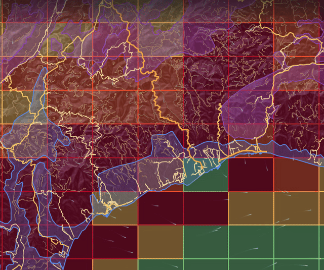

<div align="center">

# Ulinautas

### Two satellites, one dataset, one map to understand a wildfire as it unfolds

[](https://github.com/Maj-e/basajaun/actions/workflows/ci.yml)
[](https://maj-e.github.io/basajaun/)
[](docs/wiki/README.md)

<a href="https://maj-e.github.io/basajaun/">
  
</a>

**[▶ Open the live demo](https://maj-e.github.io/basajaun/)** — it opens on the Sierra Bermeja fire (Málaga, Sep 2021), paused on its peak. Press play.

<br>
<sub>Scan to open the demo on your phone</sub>

</div>

---

## The problem

NASA's FIRMS service publishes wildfire detections from two families of satellites, **MODIS** (~1 km pixels) and **VIIRS** (~375 m). They are valuable, but hard to use together:

- they use **different resolutions, confidence scales and column names**, and the same fire is often reported twice;
- the output is a flat CSV: it says *where* a satellite saw heat, not **how the fire evolves**, **who is exposed**, or **where the wind is pushing it**;
- people who must decide (civil protection, municipalities, journalists, citizens) need a picture, not a table.

## Our proposal

**Harmonize MODIS and VIIRS into a single dataset, and turn it into a replayable map that adds the context needed to read a fire:** wind, population, roads, water, risk and evacuation estimates. Everything runs from open data, with no server to operate, so it can be published, refreshed and trusted.

## What we built

**1 · One dataset from two satellites.** Both sensors are normalized to one schema (confidence, UTC time, FRP, brightness, resolution) and deduplicated: a fire seen by both becomes one hotspot, `detected_by: ["MODIS","VIIRS"]`. On the map MODIS shows as rings and VIIRS as dots, so the origin stays readable.

| | MODIS | VIIRS | Harmonized |
|---|---|---|---|
| Resolution | ~1 km | ~375 m | `resolution_m` |
| Confidence | 0–100 | `low` / `nominal` / `high` | `low` / `medium` / `high` |
| Brightness | `brightness` | `bright_ti4` | `brightness_k` |
| Date | `acq_date` + `acq_time` | same | `timestamp_utc` (ISO 8601) |
| Double detection | — | — | a single hotspot, `detected_by: ["MODIS","VIIRS"]` |

**2 · A fire you can replay.** A timeline with the fires per day, a peak-day jump, speed control and a clock. Hotspots are grouped into fires whose **perimeters grow with the clock**; the 6-hour **spread** projection, the **evacuation zone** and the **risk level** are recomputed every 6 hours of each fire's life. Wind particles move while it plays. When a fire stops being detected, its zones disappear and only the faint burned area remains. Header figures and alerts follow the visible area: zoom on a zone or click a fire and everything is recomputed for it.

**3 · Context and exposure.** Layers for wind, rain, population density, water, rivers, roads, fire stations, water points for firefighting, aquifers and regions, over Topo, Satellite or Dark base maps. For every fire the page computes **typed alerts** (people within 1 / 5 / 10 km, smoke downwind, strong wind, groundwater contamination by ash), a **combined risk score** and an **evacuation estimate**.

**4 · Several places, one pipeline.** Three episodes ship ready — **Sierra Bermeja** (1,467 detections, every layer, real alerts), **Galicia, Aug 2025** (4,301 hotspots, 238 fires) and **Chile–Argentina, Feb 2026** — chosen from a selector. A new place is an entry in a JSON file and one command. A **live mode** refreshes the last 48 hours every 30 minutes.

**5 · Predictive ignition risk (AI).** Besides what the satellites already saw, the page shows **where a new fire is most likely to start**. A model trained on the episode's own history (weather, distance to roads, fire stations and water, population, slope, and the ignitions FIRMS actually detected) scores every cell of a 12 × 12 grid, day by day. It is a calibrated logistic regression, validated out of time, and each cell carries the factors behind its score and a recommended action. Cells are coloured by relative level — **critical, high, moderate, low** — and follow the clock together with the observed fire.

<div align="center">



*Sierra Bermeja zoomed in: observed hotspots and the growing perimeter over the risk grid learned by the model.*

</div>

→ [AI module](docs/wiki/ai-risk.md)

**6 · Built to be trusted.** The backend ships display-ready data and a manifest per episode; the front end is one generic loader, so adding a layer needs no front-end code. Every file is validated against a documented [data contract](docs/data_contract.md) in CI, an invalid refresh never reaches the published site, and the deploy is versioned so visitors never get a mix of old and new files. 200+ automated tests.

### How it works

```
NASA FIRMS (MODIS, VIIRS) ─┐
WorldPop · Open-Meteo ─────┼─► scripts/ (Python, `make data`) ─► web/data/episodes/<id>/*.geojson + manifest.json
OpenStreetMap · EEA ───────┘                                              │
                                                                          ▼
                                        web/ (HTML + JS + MapLibre) ─► GitHub Pages
```

Python computes static files, the page only reads them: **nothing can go down during a demo**, and data is as fresh as FIRMS itself (~3 h after each satellite pass). Stack: Python 3.11 + [uv](https://docs.astral.sh/uv/), GeoJSON, plain JavaScript with MapLibre GL JS, GitHub Pages and Actions. Details and the alternatives we set aside: [Architecture](docs/wiki/architecture.md).

## Try it

```bash
make serve               # the site at http://localhost:8000, no key needed

cp .env.example .env     # FIRMS_MAP_KEY, only to rebuild data
make install             # uv sync → .venv with the locked dependencies
make test                # pytest
make data                # the pipeline for the default episode
make data EPISODE=galicia-2025-08   # another episode (list: make episode)
make live                # last 48 h → web/data/processed/live/
```

## Documentation

| I want to… | Read |
|---|---|
| see what the page does today | [Features](docs/wiki/features.md) |
| understand the project and the team | [Overview](docs/wiki/overview.md) |
| know the stack, data flow, files and layout | [Architecture](docs/wiki/architecture.md) |
| understand the AI ignition-risk model and its limits | [AI module](docs/wiki/ai-risk.md) |
| know what each data source gives and its quirks | [Data sources](docs/wiki/data-sources.md) |
| run the pipeline and know what each script does | [Data pipeline](docs/wiki/data-pipeline.md) |
| read the data from the front end, or add a layer | [Front end](docs/wiki/front-end.md) · [Front-end layers](docs/frontend_layers.md) |
| know the exact format of every file | [Data contract](docs/data_contract.md) · [JSON schemas](docs/schemas/) |
| handle the API key, quotas, deploy and live refresh | [Operations](docs/wiki/operations.md) |
| tell the demo story on stage | [Demo script](docs/demo-script.md) |
| see what is done, decided and next | [Status and decisions](docs/wiki/status.md) · [`TODO.md`](TODO.md) |
| check licences and attribution | [Licences](docs/licenses.md) |

The wiki index is [`docs/wiki/`](docs/wiki/README.md). Everything in this repository is in English. Keep the wiki and `docs/frontend_layers.md` up to date in the same PR as the change they describe.

## Data sources

| Use | Source |
|---|---|
| MODIS / VIIRS hotspots | [NASA FIRMS](https://firms.modaps.eosdis.nasa.gov/) (API with MAP_KEY) |
| Wind and weather | [Open-Meteo](https://open-meteo.com/) historical archive (ERA5) |
| Population | [WorldPop](https://www.worldpop.org/) 1 km |
| Water, roads, fire stations | [OpenStreetMap](https://www.openstreetmap.org/) (Overpass) |
| Water and borders | [Natural Earth](https://www.naturalearthdata.com/), geoBoundaries |
| Groundwater bodies (Europe) | [EEA](https://www.eea.europa.eu/) |
| Relief and satellite base maps | Mapterhorn, EOX Sentinel-2 cloudless, NASA GIBS |

Attribution and usage terms per source (some still to verify before a public launch): [`docs/licenses.md`](docs/licenses.md).

## Team and workflow

| Role | Focus |
|---|---|
| **B1–B4** — Backend | harmonization, ingestion and fires, aggregates and population, data platform and CI (`scripts/`, `docs/`, workflows) |
| **F** — Front end / DevOps | the page, the layer loader, deployment (`web/`) |
| **AI module** — Sergey | ignition-risk model (`ml_features.py`, `risk_ml.py`) |

Branches: `feature/<task-id>-<name>` → PR to **`dev`** → `dev` is merged into **`main`** (published) once checked. One task in [`TODO.md`](TODO.md) = one branch = one short PR, merged only with green CI.

## Future improvements

What we would do next, roughly in order of value. The full list is in [`TODO.md`](TODO.md#5-future-improvements-found-while-polishing-the-demo-15-nov-2026).

**Make the replay tighter**
- Keep the map and the timeline perfectly in step on slower machines: lighter always-on layers, capped wind animation, shorter trails.
- Timeline bars per hour (or a cumulative curve) instead of per day, so they follow each satellite pass.
- Finer, continuous zones (spread, evacuation, risk) instead of 6-hour steps.

**Go further with the data**
- Merge the **AI ignition-risk** module into the main line and add it to every episode; validate it on more fires and more years before calling it a forecast.
- Slope and land cover for every fire, and spread driven by them.
- **Alerts on live data** and **notifications**, so the live mode warns instead of only showing.
- Group alerts into incidents, and a region selector.
- A *Live* button in the interface, and a calendar with filters.

**Make it easier to trust and to share**
- A *data transparency* panel: for every layer, what it is, where it comes from and how far to trust it.
- Check and settle the **licences** marked "to verify" (and the non-commercial satellite base map) before any public launch.
- Spanish interface, mobile polish and **animation export** (GIF / MP4).

**Scale it**
- Lighter large episodes (compression, trimmed properties, coarser weather) and self-hosted map tiles if traffic grows.
- An automated browser test for the playback, and a stable public domain.
