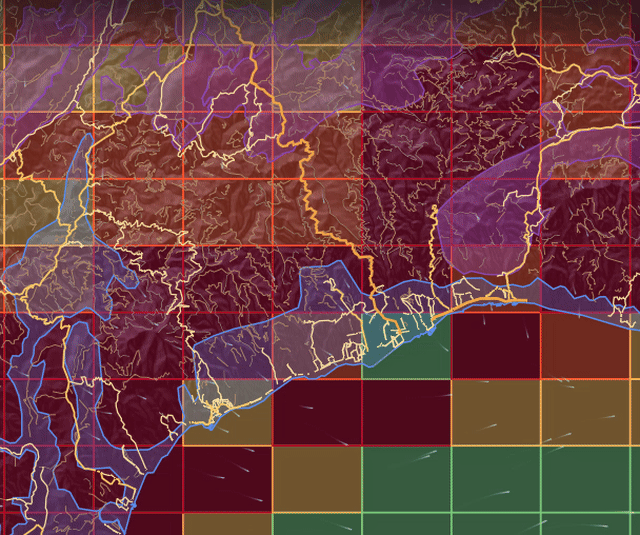

# Municipal ignition risk (AI module)

A predictive layer next to the observed ones: **where is a new fire most likely to start today?** Built by Sergey. The rest of the page shows what the satellites already saw; this layer estimates what could ignite.



## What it produces

`ignition_risk.geojson` per episode: a **12 × 12 grid** (cells `SEC-001` … `SEC-144`) over the episode's bbox, with **one score per cell and per day**.

| Property | Meaning |
|---|---|
| `cell_id`, `reference_date` | cell and day (UTC) |
| `t` | midnight UTC of that day, in hours since 1970 (the same clock as `weather.geojson`) |
| `ignition_prob`, `risk_pct` | calibrated probability (0–1) and the same as a percentage |
| `risk_level` | `critical` / `high` / `moderate` / `low` (see [Risk levels](#risk-levels)) |
| `drivers`, `top_drivers` | what pushes the score up in that cell, in words and with each factor's share |
| `recommended_action` | one-line suggestion for the municipality, by level |
| `fill`, `color`, `opacity`, `stroke` … | style, already computed (the backend ships display-ready data) |

The file also carries `model_metrics` at its root: algorithm, validation strategy, `val_roc_auc`, `val_pr_auc`, `brier_score`, `feature_importances`, `calibration` and `tier_counts` (cells per level on the latest day).

## How it works

```
 weather.geojson · roads · fire_stations · water · population.tif · (slope)
                         │
        scripts/ml_features.py (IA1): one row per cell and day, 12×12 grid
                         │  X, y, records, feature_names (no NaN)
        scripts/risk_ml.py (IA2): model, validation, tiers, drivers
                         │
              ignition_risk.geojson  ──►  make_manifest.py (IA3) ──►  layer `ignition_risk`
```

- **Features** (per cell and day): max temperature, minimum humidity, maximum wind, rain sum, the *30-30-30* fire-weather index, distance to roads, fire stations and water (UTM metres), population density, slope (when a DEM is available) and position.
- **Label**: did FIRMS detect a real ignition in that cell that day (`y ∈ {0, 1}`).
- **Model**: **L2-regularised logistic regression** with balanced classes, written with `numpy` / `scipy` only (no new dependency), plus **Platt scaling** to calibrate the probabilities.
- **Validation**: *out-of-time* 70 / 30 split by days; if one side has no positives it falls back to stratified k-fold, and to the base rate when there is nothing to learn. Reported as ROC-AUC, PR-AUC and Brier score.
- **Explanation**: per-cell linear contributions (SHAP-like) give the `drivers`.

## Risk levels

Levels are **relative to the episode**, not absolute probabilities: every cell of every day is ranked together and the top **12.5 %** are `critical`, the next **25 %** `high`, the next **34.7 %** `moderate` and the rest `low`. A dangerous day therefore has more critical cells than a calm one, and the map always has something to read. (An absolute rule, `classify_risk_tier`, also exists in the code but is not used for the layer.)

## On the map

- Layer `ignition_risk`: type `fill`, **temporal**, `hold_hours: 24`, switched on in the manifest and **on at start**, drawn underneath the groundwater, roads and fires so it never hides them. `hold_hours` is a new optional manifest field (default 1): a temporal feature stays visible that many hours, so the daily surface lasts until the next midnight UTC. See the [data contract](../data_contract.md).
- Popup: cell, date, level, risk %, drivers and recommended action. Legend with the four levels.
- Pipeline: `risk_ml` runs inside `make data`, before `make_manifest`. Tests: `test_ml_features.py`, `test_risk_ml.py`, `test_ml_integration.py` (every published episode must have the inputs the model reads).

## Limits (say them out loud in a demo)

- It is trained on **the same episode it scores** (a few days of one area), so the metrics are indicative: e.g. Chile, Feb 2026: ROC-AUC 0.74, PR-AUC 0.25; Sierra Bermeja, Sep 2021: ROC-AUC 0.87 but PR-AUC 0.07 with very few ignitions. It is **not** a validated operational forecast.
- The 12 × 12 grid is coarse; levels are relative, so "critical" means "among the worst cells of this episode", not a fixed danger level.
- Ignition risk is a different question from the **spread**, **risk score** and **evacuation** layers, which describe fires that already exist ([Features](features.md)).
